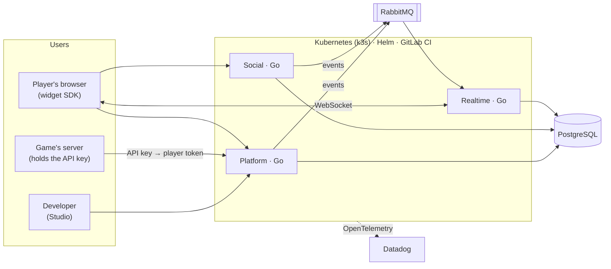

# Sociable

**Clans, friends and chat for web games, ready to embed.**
A developer designs the social widget in Studio, pastes one `<script>` tag into the game, and players get friends, clans and live chat. Restyle and publish again at any time: every open widget updates live, with no game update.

Built as the capstone project of Xsolla School Baku.

## How it fits together

## Repositories

| Repo | What it is | Stack |
|---|---|---|
| [clan-backend](https://github.com/sociable/clan-backend) | Platform, Social and Realtime services, Helm chart, load tests | Go, PostgreSQL, RabbitMQ, k3s, Traefik |
| [clan-frontend](https://github.com/sociable/clan-frontend) | Studio: the widget editor, game and team management, admin panel | React, Vite, TanStack Query |
| [clan-sdk](https://github.com/sociable/clan-sdk) | The embeddable widget players see | Plain JavaScript, Shadow DOM, under 60 KB gzipped |
| [demo-game](https://github.com/sociable/demo-game) | Harvest Village, a farming browser game with Sociable embedded | Node.js, SQLite |

## Highlights

- **No code to restyle.** Colours, layout, tabs and chat rules are set in Studio, versioned, and can be rolled back. Players only ever see published versions.
- **The API key never reaches the browser.** The game's server trades it for a one-hour player token, signed by Platform with Ed25519; Social and Realtime verify it with the public key only.
- **Live updates.** A publish goes through RabbitMQ to Realtime, which signals every open widget over its WebSocket.
- **Load tested.** 500 players at once on the live server: 0 of 136,100 requests and 0 of 3,930 chat messages failed.

## Team

Murad Hasanli · Nuray Mukhtarli · Farida Shakikhanli
Lead: Orkhan Taghizade
